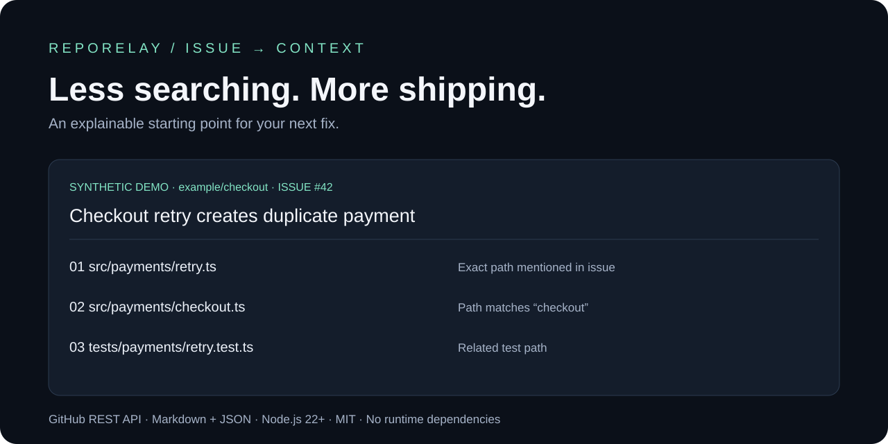

<div align="center">

# RepoRelay

### Less searching. More shipping.

**Turn a GitHub issue into an explainable coding context pack.**

[Quick start](#try-it-in-30-seconds) · [Example output](docs/example.md) · [How it works](#how-it-works) · [Contribute](CONTRIBUTING.md)

[](https://github.com/brunnojob/reporelay/actions/workflows/ci.yml)

[](LICENSE)

</div>



A bug report is open. The codebase is unfamiliar. Before you can fix anything, you need to find where to start.

RepoRelay reads an issue and a commit-pinned repository tree through the GitHub REST API. It produces **candidate files with reasons, related test paths and an implementation checklist** you can read yourself or hand to a coding assistant.

No AI subscription. No runtime dependencies. No cloning required for remote analysis. No repository writes.

## Try it in 30 seconds

Requires **Node.js 22 or 24**. No package installation required.

```sh
git clone https://github.com/brunnojob/reporelay.git
cd reporelay
node src/cli.js --demo
```

Then use a real issue:

```sh
node src/cli.js https://github.com/OWNER/REPO/issues/123 > issue.pack.md
```

Replace `OWNER`, `REPO` and `123` with an existing issue. Public repositories work without a token, subject to GitHub's API limits. For authenticated requests, provide `GITHUB_TOKEN` through your environment. Never put a token in a URL or command argument.

<details>
<summary><strong>Explore the bundled example</strong></summary>

The synthetic issue says: **“Checkout retry creates duplicate payment”**, and explicitly names `src/payments/retry.ts`.

| Candidate | Evidence |
| --- | --- |
| `src/payments/retry.ts` | Exact path mentioned in issue, plus matching terms |
| `src/payments/checkout.ts` | Matching checkout/payment vocabulary |
| `tests/payments/retry.test.ts` | Matching path and related test naming |

`src/profile/avatar.ts` is unrelated and excluded. Common credential paths and generated directories are filtered. The report finishes with a checklist for reproduction, inspection, regression testing and verification.

Run `npm run demo` to reproduce it. [Read the actual generated Markdown](docs/example.md).

</details>

## Choose your handoff

| Workflow | Command | Result |
| --- | --- | --- |
| Start a fix | `node src/cli.js ISSUE_URL` | Markdown on stdout |
| Feed another tool | `node src/cli.js ISSUE_URL --format json` | Structured versioned JSON |
| Reduce the candidate list | `node src/cli.js ISSUE_URL --limit 5` | Up to five candidates |
| Try offline | `node src/cli.js --demo` | Reproducible synthetic fixture |

Redirect stdout to a file or pipe it to your own workflow. Diagnostics go to stderr. Exit code `0` means the pack was produced; `1` means invalid arguments or API failure. No matches is a valid result, explicitly reported.

## How it works

1. Validate a canonical GitHub issue URL.
2. Read issue and repository metadata.
3. Resolve the default branch to a commit and read its Git tree.
4. Rank eligible paths by issue vocabulary and explicit path mentions.
5. Export evidence, related tests, snapshot identity and a checklist.

**Four read-only API requests per successful pack.** No repository scripts, shell commands or issue instructions are executed. Scores order matches; they are not confidence percentages. The engine is deterministic for the same input.

<details>
<summary><strong>What exactly is implemented?</strong></summary>

- Canonical GitHub issue URL validation and pull-request rejection.
- Commit-pinned recursive tree retrieval.
- Explainable path ranking and related test path discovery.
- Common sensitive/generated path filtering.
- Markdown and JSON exports, bounded candidate counts.
- Explicit rate-limit, API error, timeout and truncated-tree handling.
- Offline fixture and cross-platform test workflow.

This version does **not** read file bodies, parse imports, infer a dependency graph, generate patches, or automatically fix issues. Candidate selection is a starting point that needs human verification. The project is an initial **v0.1.0**, not a semantic code intelligence engine.

</details>

<details>
<summary><strong>Can I use it with Copilot or another coding assistant?</strong></summary>

Yes. Generate Markdown, inspect it, and attach it to your coding session. Ask the assistant to verify candidates, read repository instructions and reproduce the issue before editing. RepoRelay does not integrate with an AI service or send the pack to one automatically.

Issue text and repository data can contain malicious instructions. Treat them as task data, not authorization to execute commands or disclose secrets.

</details>

<details>
<summary><strong>Tokens, privacy and API limits</strong></summary>

`GITHUB_TOKEN` is optional for public repositories. Use the least privileges needed to read the target repository. Private repository access depends on the token and your GitHub permissions; do not share generated private packs publicly.

Tokens are sent only in the Authorization header to `api.github.com`. Redirects are rejected. Tokens are not placed in reports or saved by the tool. JSON includes the issue body; both output formats include repository identity and file paths. Inspect reports before sharing.

GitHub applies API limits according to authentication and endpoint policies. GitHub Pro or Developer Program membership is not a substitute for token permissions or unlimited API access. On rate limits, the CLI fails explicitly instead of emitting a partial success. See [GitHub's REST API rate limits](https://docs.github.com/en/rest/using-the-rest-api/rate-limits-for-the-rest-api).

</details>

## Why alongside PatchScope?

| Tool | Moment | Input | Output |
| --- | --- | --- | --- |
| [PatchScope](https://github.com/brunnojob/patchscope) | Reviewing a change | Git diff | Review prompts |
| RepoRelay | Starting a change | GitHub issue + repository tree | Coding context pack |

Use RepoRelay to find your starting point. Use PatchScope to inspect the resulting patch.

## Development

```sh
npm run check
npm test
npm run demo
```

Tests cover ranking, unrelated-file exclusion, sensitive paths, empty matches, incomplete trees, Markdown escaping, URL validation, commit-pinned requests, rate limits, pull-request rejection and CLI validation. CI runs on Linux and Windows with Node.js 22 and 24. Network behavior is tested with mocks; the offline demo needs no credentials.

| Module | Responsibility |
| --- | --- |
| `src/github.js` | URL validation and read-only GitHub API client |
| `src/engine.js` | Ranking, test discovery and Markdown export |
| `src/cli.js` | Argument validation and stdout/stderr contract |
| `src/demo.js` | Synthetic reproducible example |
| `test/` | Behavior and API contract tests |

## Build the next version with us

The next substantial step is **local import-graph evidence**, followed by opt-in source excerpts and a browser workspace. These are planned features, not current capabilities. See [architecture and boundaries](docs/architecture.md).

Useful contributions: a difficult issue/path fixture, a ranking false positive, better Portuguese vocabulary handling, or a focused regression test. Reports in English and Portuguese are welcome. Start with [CONTRIBUTING.md](CONTRIBUTING.md).

If RepoRelay saves you time, a star helps other developers discover it. Reproducible feedback helps make it better.

Created by [brunnodev](https://brunnodev.store) · [brunnojob](https://github.com/brunnojob) · [MIT License](LICENSE)
